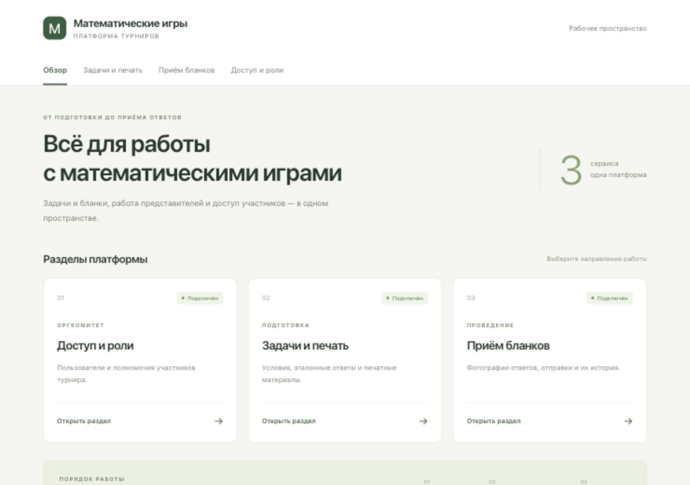

# Olympiad Services

Учебный проект по микросервисной архитектуре: доступ и роли, задачи и печать, приём бланков.

## Что готово

- Три отдельно запускаемых приложения ASP.NET Core.
- Общий интерфейс React с навигацией по разделам.
- Проверка доступности сервисов из интерфейса.
- Запуск через Docker Compose и автоматическая проверка в GitHub Actions.

Вход, назначение ролей, редактор задач и загрузка бланков будут добавлены следующими PR. Таблица ролей сейчас описывает планируемые права; авторизация ещё не реализована. Базы данных и брокер в этот каркас не входят.

## Интерфейс



## Запуск через Docker

Установите и запустите Docker Desktop. Из корня репозитория выполните:

```bash
docker compose up --build -d
```

Откройте [http://localhost:8080](http://localhost:8080). На странице обзора все три сервиса должны иметь статус «Подключён».

Остановка:

```bash
docker compose down
```

Просмотр журналов:

```bash
docker compose logs -f
```

## Запуск без Docker

Понадобятся [.NET SDK 10.0.403](https://dotnet.microsoft.com/en-us/download/dotnet/10.0) и [Node.js 22.21.0](https://nodejs.org/en/download). Версии закреплены в `global.json` и `.nvmrc`.

Из корня репозитория:

```bash
dotnet build OlympiadServices.slnx
npm --prefix web ci
```

Запустите каждую команду в отдельном терминале из корня репозитория:

```bash
dotnet run --project src/Access/Access.Api --launch-profile http
```

```bash
dotnet run --project src/TasksPrinting/TasksPrinting.Api --launch-profile http
```

```bash
dotnet run --project src/Submissions/Submissions.Api --launch-profile http
```

```bash
npm --prefix web run dev
```

Откройте [http://localhost:5173](http://localhost:5173). Frontend перенаправляет запросы API к сервисам через Vite proxy; отдельная настройка CORS не требуется.

Если порты backend отличаются, скопируйте `web/.env.example` в `web/.env`, укажите адреса и перезапустите frontend. Для стандартного запуска этот файл создавать не нужно.

## Структура

| Папка | Назначение |
|---|---|
| `src/Access/Access.Api` | Доступ и роли |
| `src/TasksPrinting/TasksPrinting.Api` | Задачи и печать |
| `src/Submissions/Submissions.Api` | Приём бланков |
| `web/src/features/access` | Страницы доступа и ролей |
| `web/src/features/tasks-printing` | Страницы задач и печати |
| `web/src/features/submissions` | Страницы приёма бланков |
| `web/src/app` | Общая навигация и оформление |
| `web/src/shared` | Общие компоненты и работа с API |

## Адреса сервисов

| Сервис | Адрес | Проверка | Информация |
|---|---|---|---|
| Доступ и роли | `http://localhost:5101` | `/health` | `/api/service` |
| Задачи и печать | `http://localhost:5102` | `/health` | `/api/service` |
| Приём бланков | `http://localhost:5103` | `/health` | `/api/service` |

Из браузера запросы идут через frontend, например `/api/access/health` и `/api/access/api/service`. Префикс `/api/access` убирается proxy; backend получает `/health` и `/api/service` соответственно.

## Проверки

```bash
dotnet build OlympiadServices.slnx --configuration Release
npm --prefix web run build
```

После запуска через Docker или локальных терминалов:

```bash
node scripts/check.mjs
```

Для Vite вместо Docker:

```bash
node scripts/check.mjs http://localhost:5173
```

Проверка обращается к реальным приложениям: frontend, маршрутам страниц и каждому backend через proxy. GitHub Actions собирает контейнеры и выполняет эту же проверку.

## Работа с Git

- `main` — готовая версия для сдачи.
- `develop` — общая ветка разработки.
- `feature/*` — новые возможности, PR в `develop`.
- `fix/*` — исправления, PR в `develop`.
- `release/*` — подготовка версии, PR в `main` с переносом изменений в `develop`.
- `hotfix/*` — срочные исправления готовой версии с переносом в `main` и `develop`.

Каждый участник начинает feature-ветку от актуальной `develop` после слияния каркаса. Каждый делает backend и страницы своего раздела; изменения общих маршрутов и конфигурации согласовываются с командой.

Коммиты — Conventional Commits: `feat:`, `fix:`, `chore:`, `docs:`, `refactor:`, `test:`, `ci:`.
